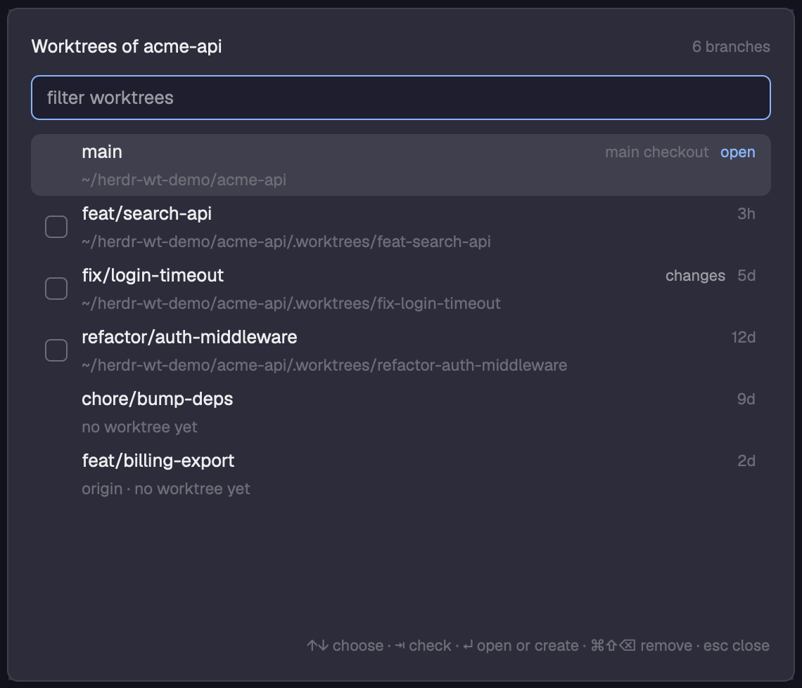

# herdr-wt

A [Herdr](https://herdr.dev) mod: one dialog to open, create and remove git worktrees with [worktrunk](https://github.com/max-sixty/worktrunk). Press ⌘⇧G in any space, local or on another machine.



## Install

Paste this to the agent in your Herdr window:

```
Read ~/.config/herdr-app/AGENTS.md, then add this mod: github.com/SentioLabs/herdr-wt
```

Or by hand:

```sh
git clone https://github.com/SentioLabs/herdr-wt
cp -R herdr-wt/mods/wt ~/.config/herdr-app/mods/
herdr-app check ~/.config/herdr-app/mods/wt
```

Then merge `keys.json` into `~/.config/herdr-app/keys.json`. If you already have a `wt` mod, rename this one's folder and its `mod.open:wt` key to match. If ⌘⇧G is taken (other git mods use it too), pick another key.

It needs `git` and `wt` on every machine you use it with. It approves worktrunk's hook prompts (`--yes`) because there's no terminal to answer them.

[RECIPE.md](RECIPE.md) describes the mod in enough detail to rebuild it on another Herdr version.

## License

MIT. See [LICENSE](LICENSE).
