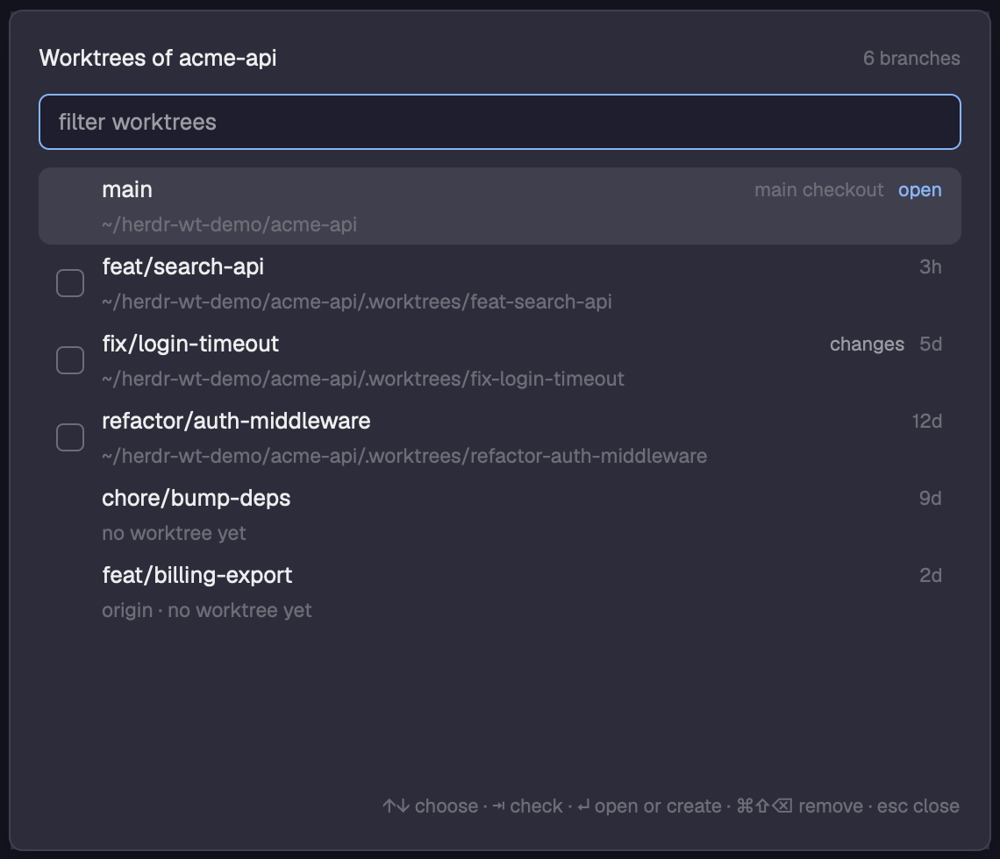

# Worktrees (wt)

⌘⇧G opens one dialog for a repo's git worktrees: open one, make one from any local or remote branch, or check several and remove them. It drives [worktrunk](https://github.com/max-sixty/worktrunk) (`wt`), so worktrunk's path template and hooks apply. It works the same in spaces on other machines. This is a piece you add to your current layout, not a whole window.

This file is the brief: enough to build the mod from an empty folder. The files next to it are one build of it. If they don't work on your Herdr, or you want it different, build it again from here.

## What you see

- A dialog, 560px wide and 480px high. Nothing is added to the layout itself.
- A heading, "Worktrees of <repo>", with the row count on the right ("6 branches", or "2/6 branches" while filtering).
- A filter input with the placeholder "filter worktrees".
- A scrollable list of 44px rows. Each row shows the branch and, under it, the worktree path with the home folder as `~`. A branch without a worktree says "no worktree yet", with its remote first ("origin · no worktree yet") when it only exists there.
- Tags on the right of the branch line: "main checkout", "open" (a space already shows it), "changes" (uncommitted changes) and the age of its last commit.
- A checkbox on the left of every linked worktree. The main checkout and branches without a worktree get an empty column the same width.
- When the filter text names no branch, a last row "+ Create <name>" with "wt switch -c" on the right.
- A footer: "↑↓ choose · ⇥ check · ↵ open or create · ⌘⇧⌫ remove · esc close".
- Theme colors only: popover background, foreground text, accent for "open" and checked boxes, blocked (red) for removal warnings and errors.

## How it behaves

| Key | Action |
| --- | --- |
| Typing | Filters rows by branch and path |
| ↑ / ↓ | Move the highlight, wrapping, and scroll it into view |
| ↵ | On a worktree: show the space it's open in, or open a new space there. On a branch without one: `wt switch <branch>`, then a new space. On the create row: `wt switch --create <name>`. An exactly typed branch name wins over the highlight |
| ⇥ or a click on the box | Check or uncheck a linked worktree |
| ⌘⇧⌫ | Arm removal of the checked worktrees, or of the highlighted one when none is checked. A red line asks "Remove 3 worktrees, losing uncommitted changes in 1?" and the armed paths turn red |
| ⌘⇧⌫ again | Remove them one by one. The dialog stays open and reloads the list. Failed ones stay checked and their errors show |
| Escape | Disarm a pending removal, else close |

Typing, moving the highlight or toggling a box disarms a pending removal. A new space is left unnamed so it follows its folder and nests under the repo in the sidebar.

Removing a worktree first closes the space showing it, then runs `wt remove <branch> --foreground --yes`, adding `--force` when it has uncommitted changes. worktrunk deletes the branch only when it's merged. `removeFlags()` at the top of `main.js` is the place to change that policy.

## Built from

- **One mod**, `mods/wt/`, with `main.js` and `mod.json`. The manifest has `place: "none"` and a dialog overlay, so there's no `layouts/` folder or layout change.
- **A `keys.json` snippet**, merged into the person's keys rather than replacing them: `{ "global": { "cmd-shift-g": "mod.open:wt" } }`.
- **Data:** `wt list --branches --remotes --format=json` for the rows, and `git rev-parse` to find the repo. Everything runs through `exec(..., { cwd, on })` with `on` set to the space's machine.
- **Commands:** `space.select`, `space.new {folder, machine}` and `space.close {id, confirmed}`, dispatched with `run()`.
- **Elements:** `gpui-kit` views with `gpui-base` `InputState`, `Input`, `Checkbox`, `Scrollbar` and `ScrollHandle`.
- **Optional props**, for opening it from another mod or a menu: `{ space }` or `{ folder, machine }` pick the repo, `{ branch }` switches to it at once, `{ tab, argv }` go to the new space.
- Started from Herdr's shipped `worktree` mod (0.1.13), which Herdr wrote. The list, checkboxes, worktrunk calls and removal are new.

## Watch out

- **A key binding opens the mod with no props.** Fall back to the shown space (`spaces().find((s) => s.active)`) and pass its `machine` as `on`. Without it every command runs on this computer. In a remote space that fails with "cannot run git: No such file or directory (os error 2)" because the remote folder doesn't exist here.
- **Focus.** The filter input only mounts once the list has loaded. Focus the root's handle in `init`, then the input 100ms after the list arrives. A focus call made while loading lands on nothing and the dialog ignores every key.
- **Keep the checkbox out of the open click.** The checkbox and the clickable text column are siblings in the row. `Checkbox` reports through `on_change`, so a `stop_propagation()` in its `on_click` doesn't stop the row's handler.
- **Two `wt list` formats.** Schema 2 (current) is `{ schema, items }` with worktree fields under `worktree` and remote branches as `{ branch: "foo", remote: "origin" }`. Older versions (v0.61) print a bare array with `path`, `is_main`, `working_tree` and `commit.timestamp` at the top, and name remote branches `origin/foo`. Read both, and treat `origin/foo` as existing so it isn't created as a new branch.
- **`--yes`.** There's no terminal to answer worktrunk's approval prompts, so `wt switch` and `wt remove` approve hooks without asking, and hook output only shows on failure. Disclose this.
- **Removing the folder the dialog came from.** Later `wt` calls can't run in a deleted folder, so switch the working folder to the main checkout first.
- **Keys.** ⌘⌫ is often bound to clear the terminal line, hence ⌘⇧⌫. ⇥ must reach the root's `on_key_down`. If the input or the app takes it, checking still works by click.
- Requires `git` and worktrunk's `wt` on every machine you use it on, found on the PATH Herdr's `exec` sees. That PATH can differ from your interactive shell's, so a stale `wt` (for example in `~/.cargo/bin`) can win.
- Follow the installed `herdr.d.ts` and `gpui-kit.d.ts`, and never modify shipped mods.

## Done when

- `herdr-app check mods/wt` passes with the matching Herdr binary and home.
- ⌘⇧G in a space inside a repo lists its worktrees, local branches and remote branches. Outside a repo it says "<folder> is not in a git repository."
- The same works in a space on another machine (`hc machine ls`).
- Typing filters, ↑/↓ move and scroll, ↵ opens or switches to the right space, and a new name creates a branch and worktree through worktrunk.
- Clicking a checkbox checks it and doesn't open the worktree.
- ⌘⇧⌫ arms and shows what will be lost, esc disarms, and ⌘⇧⌫ twice removes the checked worktrees and leaves the dialog open on the refreshed list.
